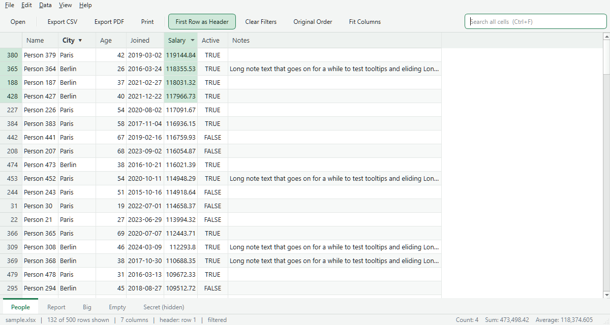
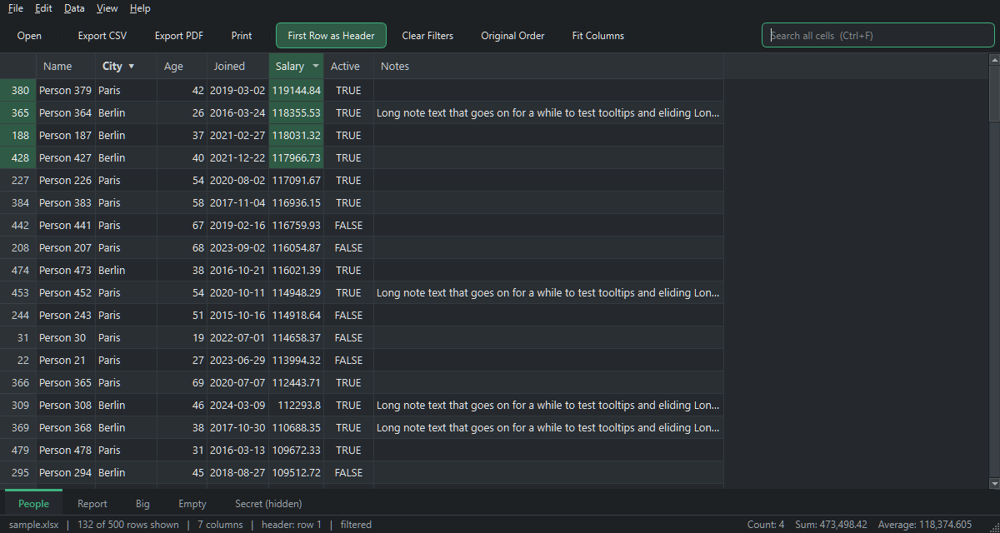
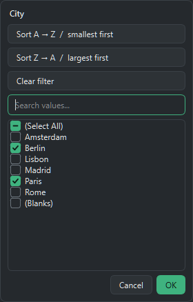

<p align="center">
  
</p>

<h1 align="center">Pexcel</h1>

<p align="center">
  <b>You don't need Excel to view Excel.</b><br>
  Pexcel (Personal Excel) is a spreadsheet viewer that opens your files, shows them, and then has the decency to leave them alone.
</p>

<p align="center">
  
</p>

---

## The problem

Someone emails you `Q3_final_FINAL_v2 (3).xlsx`. You want to *look* at it. That's it. Just look.

Your options were:

1. Open Excel. Wait. Sign in. Get told your license needs attention. Dismiss a "What's New" panel. Get asked about Copilot. Get told the file is in Protected View. Click "Enable Editing" by accident. Get asked whether to save changes to a file you didn't change. Close Excel. Stare into the distance.
2. Upload it to some website and hope the company's payroll doesn't end up training somebody's model.
3. Rename it to `.zip` and read raw XML like it's 1998.

## The solution

Pexcel. Double-click, see data. Groundbreaking stuff, really.

- Opens in about a second, not after a splash screen and a short meditation.
- Read-only. It **cannot** save over your file. Nobody's going to "accidentally" change a number in the budget.
- Runs 100% locally. No account, no cloud, no telemetry, no "sign in to continue". It doesn't even know the internet exists.
- One `.exe`. No installer, no admin rights, no 4 GB Office suite to get a grid of numbers on screen.

## What it does

| Feature | Details |
|---|---|
| **Opens basically everything** | `.xlsx` `.xlsm` `.xlsb` `.xls` `.ods` `.csv` `.tsv`, plus the template/add-in variants your IT department forgot about. Even that `.xls` from 2003. |
| **Looks like a spreadsheet** | Grid, row numbers, sheet tabs at the bottom. Hidden sheets show up as "(hidden)", because you deserve to know what they're hiding. |
| **Sort** | Click a header, pick a direction. Blanks go to the bottom, where they belong. Sorting stacks, so you can sort by City and then by Salary. |
| **Filter** | Excel-style dropdown with a checklist of values, a search box and "(Select All)". It's the one Excel feature everybody actually uses, now without the rest of Excel. |
| **Search everything** | Ctrl+F filters to rows where any cell contains your text. |
| **Smart headers** | Guesses which row holds the column titles and skips the "QUARTERLY REPORT - CONFIDENTIAL" banner above it. Guessed wrong? Right-click a row number and pick one. |
| **Status bar math** | Select some cells and get Count, Sum and Average. Yes, like the real thing. |
| **Copy** | Ctrl+C copies the selection, ready to paste anywhere (including, ironically, Excel). |
| **Export CSV** | Saves the rows you're looking at, after filters and sorting. |
| **Export PDF / Print** | Proper pages with a repeating header, page numbers, and wide tables split across pages instead of shrunk to 2pt. |
| **Dark mode** | Follows Windows, or set it yourself. For people who open spreadsheets at 2 AM and would like to keep their retinas. |
| **Zoom** | Ctrl+wheel. For the 6pt font a colleague thought was a good idea. |

<p align="center">
  <br>
  
</p>

## What it deliberately does not do

- **Edit cells.** It's a viewer. That's the whole point. If you want to change cell B7, you're looking for a different app and probably a different career.
- **Show formulas.** You get the computed results. If you need to know *why* the total is wrong, that's a conversation for you and whoever built the sheet.
- **Formatting, merged cells, charts, pivot tables, macros.** Data in, data out. Your neon yellow headers will be fine without us.
- **Ask you to subscribe to anything.** Ever.

## Getting it

### Option A: Just give me the exe

Grab `Pexcel.exe` from the [latest release](https://github.com/geekbeard/Pexcel/releases/latest) and double-click it. It's also sitting right in the repo at [`dist/Pexcel.exe`](dist/Pexcel.exe), for people who don't trust release pages either.

Windows SmartScreen might say it "protected your PC" from an unsigned exe. That's the same Windows that ships Candy Crush preinstalled. Click **More info**, then **Run anyway**.

Tip: right-click any `.xlsx`, choose **Open with**, then **Choose another app**, then browse to `Pexcel.exe`. Now double-clicking spreadsheets opens Pexcel. You'll feel lighter.

### Option B: Build it yourself (trust issues are valid)

Needs Python 3.10+ on Windows.

```powershell
git clone <this repo>
cd Pexcel
python -m venv .venv
.\.venv\Scripts\python.exe -m pip install -r requirements-dev.txt
```

Run from source:

```powershell
.\.venv\Scripts\python.exe main.py path\to\some.xlsx
```

Build the single-file exe (lands in `dist\Pexcel.exe`, about 35 MB, which is still smaller than one Office update):

```powershell
.\build.ps1
```

Want test data? This writes `samples\sample.xlsx` with a 100k-row sheet, a hidden sheet, an empty sheet, and a sheet with a title row to trick the header detection:

```powershell
.\.venv\Scripts\python.exe tools\makeSamples.py
```

## Keyboard shortcuts

| Keys | Does |
|---|---|
| `Ctrl+O` | Open file |
| `F5` | Reload from disk |
| `Ctrl+F` | Search all cells |
| `Ctrl+C` | Copy selection |
| `Ctrl+H` | Toggle "first row as header" |
| `Ctrl+Shift+L` | Clear all filters |
| `Ctrl+Shift+R` | Back to original row order |
| `Ctrl+PgUp` / `Ctrl+PgDn` | Previous / next sheet |
| `Ctrl+E` | Export CSV |
| `Ctrl+Shift+E` | Export PDF |
| `Ctrl+P` | Print preview |
| `Ctrl+wheel`, `Ctrl+=`, `Ctrl+-`, `Ctrl+0` | Zoom in / out / reset |

## Under the hood

- **[PySide6](https://doc.qt.io/qtforpython-6/)** (Qt 6): a real native UI, not a browser in a trench coat.
- **[python-calamine](https://github.com/dimastbk/python-calamine)**: a Rust spreadsheet reader. It's the reason a 100k-row file opens in about a second.
- **[PyInstaller](https://pyinstaller.org/)**: packs it all into one exe.

On a 100,000-row sheet: load ~1s, sort ~0.25s, search ~0.5s.

```
main.py                   entry point
pexcel/workbookLoader.py  reads files (no Qt), formats values, sort keys
pexcel/sheetModel.py      table model + filter/search proxy
pexcel/filterPopup.py     the column dropdown
pexcel/exporters.py       CSV export and PDF/print page painting
pexcel/mainWindow.py      the window and everything you click
pexcel/theme.py           light/dark styling
pexcel/appIcon.py         icon, drawn in code because image files are overrated
```

## FAQ

**Is this affiliated with Microsoft?**
No. If it were, it would need a sign-in.

**Can it open password-protected files?**
No. If someone locked it, take it up with them.

**Mac / Linux?**
The code is plain Python and Qt, so it should mostly work there. The build script and polish are Windows-only for now. PRs welcome.

**Why is it called Pexcel?**
Personal Excel. It's Excel's personality minus everything you didn't ask for.

**Will you add editing?**
No. That's how you end up rebuilding Excel, and the world already has one of those.

## License

[MIT](LICENSE). Do whatever you want with it. Just don't add a subscription.
